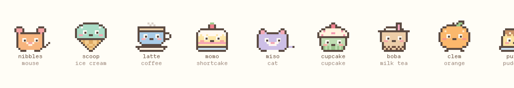
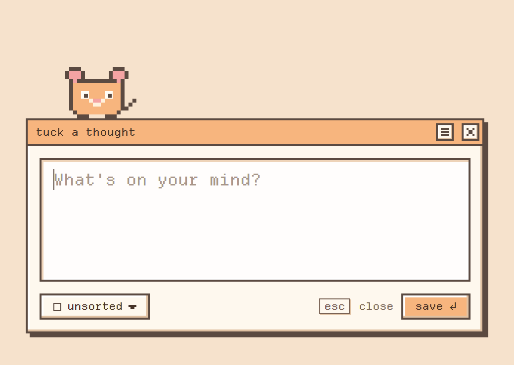
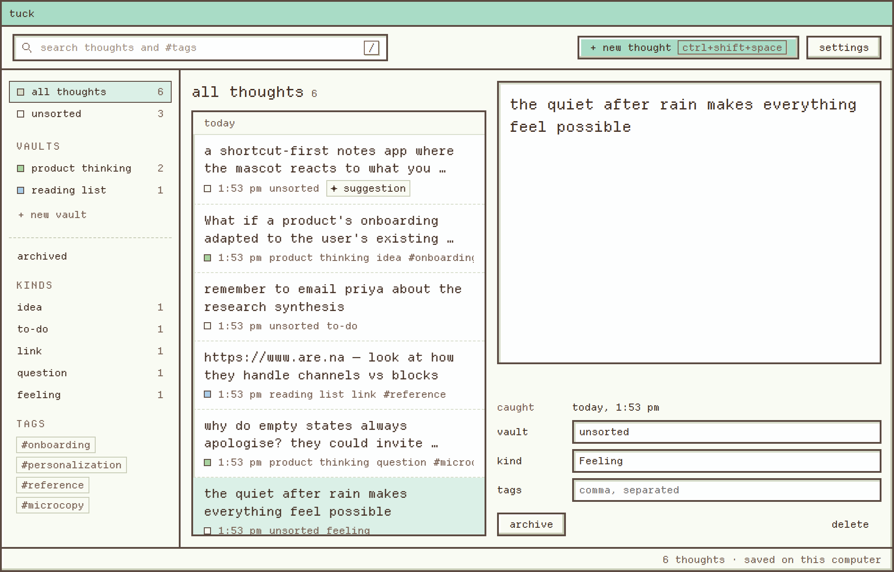

<p align="center">
  
</p>

<h1 align="center">tuck</h1>

<p align="center">
  a tiny app for catching thoughts before they fly off.<br>
  press a shortcut, type, hit enter. a little pixel buddy keeps it safe.
</p>

<p align="center">
  <a href="../../releases/latest"><b>download for windows</b></a> ·
  <a href="#how-to-use-it">how to use it</a> ·
  <a href="#faq">faq</a>
</p>

---

## why this exists

you're in the middle of something. an idea shows up. you think "i'll remember
that". you don't.

writing it down *should* be easy, but it usually goes like: open notes app, find
the right folder, make a new note, think of a title, type, and by then you've
lost your train of thought *and* the idea.

tuck skips all of that. one shortcut, a little box pops up, you type, you press
enter, it's gone and you're back to work. you sort things out later. or never.
that's fine too.

## what it looks like

<p align="center"></p>

that's the whole thing you see most days. a box, your buddy on top of it, and
the words "what's on your mind?"

<p align="center"></p>

and this is where everything ends up, when you feel like looking back.

## download and install

**works on:** Windows 10 and Windows 11. (Mac and Linux aren't ready yet.)

1. go to the [**releases page**](../../releases/latest)
2. under **Assets**, click the file that ends in **`-setup.exe`** (something like `tuck_0.1.0_x64-setup.exe`)
3. open it once it's downloaded
4. windows might show a blue box saying **"Windows protected your PC"**. that's
   normal for new apps that aren't signed yet. click **More info**, then **Run anyway**
5. click through the installer. it doesn't need an admin password, and it only
   installs for you
6. that's it. tuck opens, and you'll see your buddy hanging out on the taskbar

it's about **2 MB**, so even slow internet is fine. you don't need an account and
nothing gets uploaded anywhere.

**updates are automatic.** when a new version is out, it downloads quietly in the
background. right-click the tuck icon near your clock and you'll see
**"restart to update"**. click it whenever you like.

**want to remove it?** Windows Settings → Apps → Installed apps → tuck →
Uninstall. your thoughts stay in their folder in case you come back (see
[where your stuff lives](#where-your-stuff-lives)).

## how to use it

### the popup (this is the main thing)

press **`Ctrl` + `Shift` + `Space`** from anywhere. while you're in a browser,
a doc, a game, anything.

- **type your thought.** as long or short as you want
- **press `Enter`** to save it. your buddy hops, says "got it. tucked away.", and the box disappears
- **need a new line?** `Shift` + `Enter`
- **changed your mind?** press **`Esc`** or click anywhere else. whatever you typed is kept and will be waiting next time you open the box
- **want it in a vault?** click the **unsorted ▾** button (or press `Ctrl` + `1` for your first vault, `Ctrl` + `2` for the second, and so on. `Ctrl` + `0` puts it back to unsorted). totally optional

the two little buttons in the corner:

| button | what it does |
| --- | --- |
| **☰** | opens your library (same as `Ctrl` + `L`) |
| **×** | closes the box. your draft stays |

### the library (for later)

open it from the **☰** in the popup, from the tray menu, or by opening tuck from
the Start menu.

**on the left:**

| thing | what it is |
| --- | --- |
| **all thoughts** | everything you've ever tucked away |
| **unsorted** | only the thoughts that aren't in a vault yet |
| **vaults** | like folders. make one with **+ new vault**. drag thoughts onto a vault to move them there |
| **archived** | thoughts you've put aside. they're not deleted, you can bring them back |
| **kinds** | tuck guesses what each thought is (an idea, a to-do, a link, a question, a feeling, a quote). click one to see just those |
| **tags** | your #tags. click one to filter |

**in the middle** is the list, newest first, grouped by day. use the **search box**
at the top (or press **`/`**) to find anything. it searches your words and your
#tags.

**on the right** is the thought you clicked:

- just click into the text and edit it. it saves by itself
- **vault**: move it somewhere
- **kind**: change what type of thought it is
- **tags**: type tags separated by commas
- **archive**: put it aside without deleting
- **delete**: removes it for good. you have to click it twice so you don't do it by accident

if you're looking at a vault, there's also **rename**, **colour** and **delete**
next to its name at the top. deleting a vault never deletes your thoughts. they
just go back to unsorted.

### little suggestions

after you save, tuck sometimes guesses things like *"this looks like an idea.
tags: #onboarding. vault: product thinking"*. you'll see a small **✦ suggestion**
on the thought. open it and pick **use this** or **no thanks**.

it never changes what you actually wrote. and it all happens on your computer.
no AI service, nothing sent anywhere. you can turn it off in settings.

### your buddy

<p align="center"></p>

there are nine to pick from: **nibbles** the mouse, **scoop** the ice cream,
**latte** the coffee, **momo** the strawberry shortcake, **miso** the cat,
**cupcake**, **boba**, **clem** the orange and **purin** the pudding.

they're not just decoration. your buddy:

- watches your cursor, wherever it is on the screen
- blinks, breathes, and wags now and then
- looks at what you're typing
- does a happy hop when you save something
- falls asleep if you leave it alone for a while
- gets a little heart if you click it

**on the taskbar:** your buddy can hang out on top of your taskbar and wander
around a bit. double-click it to open the popup. drag it wherever you want and
it'll drop back down. **right-click** it for a menu:

| menu item | what it does |
| --- | --- |
| take a nap / wake up | sends it to sleep (or wakes it up) |
| do a little dance | exactly what it sounds like |
| say hi | a little hello |
| stay put / wander around | stops it walking around (or lets it again) |
| tuck a thought | opens the popup |
| see all my thoughts | opens the library |
| hide | puts it away. bring it back from the tray menu |

the whole app changes colour to match your buddy, so scoop gives you a minty
app, miso a lavender one, and so on.

### settings

click **settings** in the library.

- **your buddy**: click one to preview it
- **shortcut**: click the button, then press the keys you want (for example `Alt` + `Space`)
- **let my buddy hang out on the desktop**: the taskbar buddy, on or off
- **start when I log in**: tuck opens quietly when your computer starts
- **suggest kinds, tags and vaults**: the little suggestions, on or off
- **your data**: **show file** opens the folder, **export as markdown** saves everything as a normal text file in your Documents

nothing changes until you press **save changes**. **cancel** (or `Esc`) puts
everything back the way it was.

### the tray icon

tuck lives in the tray, near your clock. it might be hiding behind the little
**^** arrow.

- **left-click** it to open the popup
- **right-click** it for: tuck a thought, open my thoughts, show/hide desk buddy, the version (or "restart to update"), and quit

closing the library doesn't quit tuck. it's still there in the tray, waiting for
the shortcut. use **quit tuck** in the tray menu if you really want it gone.

## every shortcut

| do this | press |
| --- | --- |
| open the popup, from anywhere | `Ctrl` `Shift` `Space` (you can change it) |
| save | `Enter` |
| new line | `Shift` `Enter` |
| close the popup (draft stays) | `Esc` |
| pick a vault in the popup | `Ctrl` `1` … `9` (`Ctrl` `0` = unsorted) |
| open the library from the popup | `Ctrl` `L` |
| search in the library | `/` or `Ctrl` `F` |
| move through thoughts | `↑` `↓` |
| edit the selected thought | `Enter` |
| archive the selected thought | `Delete` |
| new thought from the library | `Ctrl` `N` |

## where your stuff lives

everything is on your computer, in one file you can open in Notepad:

```
%APPDATA%\app.tuck.desktop\thoughts.json
```

paste that into the address bar in File Explorer to go there. or use
**settings → show file**.

- tuck keeps the previous version next to it as `thoughts.json.bak`
- it never half-writes the file, so a crash or a power cut won't wipe anything
- **backing up** is just copying that folder somewhere
- **moving to a new computer**: install tuck, quit it, copy your `thoughts.json` into the same folder on the new computer, open tuck

no accounts, no cloud, no tracking, no ads. read the short [privacy note](PRIVACY.md).

## faq

**the shortcut doesn't do anything.**
another app might already be using `Ctrl` `Shift` `Space`. open settings and
pick a different shortcut.

**i can't find tuck.**
look near the clock for the icon (check behind the **^** arrow). or just open it
from the Start menu.

**i hid my buddy, how do i get it back?**
right-click the tuck tray icon → **show desk buddy**.

**the buddy is distracting.**
right-click it → **stay put**, or hide it completely. the popup still works the
same.

**can i use it offline?**
yes. it never needs the internet, except to check for updates.

**does it work with other languages?**
you can type in any language. the app's own words are in english for now.

**is it free?**
yes.

**something broke.**
sorry! please [open an issue](../../issues) and say what you clicked right
before it happened. if you can, attach `app.log` from the same folder as
`thoughts.json`. it helps a lot.

## for developers

want to build it yourself or poke around? start with
[docs/README.md](docs/README.md). it covers how everything works, how it's
designed, how it's tested and how releases get made.

```bash
npm install
npm run app:dev     # run it with live reload
npm run app:build   # make the installer
```

## thanks

the font is [Departure Mono](https://departuremono.com) by Helena Zhang. the
buddies were drawn from scratch, pixel by pixel. the whole vibe owes a lot to
[Mochi](https://likhith1542.github.io/mochi/) and old Windows pop-ups.

made with care by saanvi ✿
